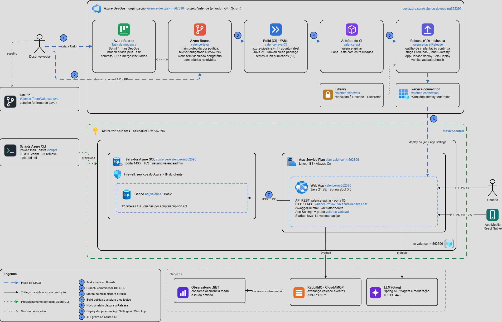

# Valence · Deploy da API Java no Azure com Azure DevOps

Global Solution FIAP 2026/2, tema CitizenTech, disciplina **DevOps Tools & Cloud Computing**.

O **Valence** é uma rede pública e colaborativa de vigilância fitossanitária para pequenos produtores de milho, tomate e batata. Este repositório tem o código da API Java do Valence e tudo o que a coloca em produção no Azure: scripts Azure CLI, script do banco, pipeline de Build em YAML e a documentação da Release.

| Link | Endereço |
| --- | --- |
| Organização no Azure DevOps | [https://dev.azure.com/valence-devops-rm562396](https://dev.azure.com/valence-devops-rm562396) |
| Vídeo da disciplina de DevOps | [https://youtu.be/iuB_7Xt6FKA](https://youtu.be/iuB_7Xt6FKA) |
| API em produção | [https://valence-rm562396.azurewebsites.net](https://valence-rm562396.azurewebsites.net) |
| Swagger | [https://valence-rm562396.azurewebsites.net/swagger-ui.html](https://valence-rm562396.azurewebsites.net/swagger-ui.html) |
| Saúde da API | [https://valence-rm562396.azurewebsites.net/actuator/health](https://valence-rm562396.azurewebsites.net/actuator/health) |
| Versão publicada | [https://valence-rm562396.azurewebsites.net/actuator/info](https://valence-rm562396.azurewebsites.net/actuator/info) |
| Vídeo pitch (Java Advanced) | [https://youtu.be/tXa5CGyGAFw](https://youtu.be/tXa5CGyGAFw) |

## Integrantes

| Integrante | RM |
| --- | --- |
| Henrique Martins Oliveira | 563620 |
| Guilherme Macedo Martins | 562396 |
| Pedro Henrique Luiz Alves Duarte | 563405 |

## Sumário

- [Solução e conceito](#solução-e-conceito)
- [Arquitetura macro](#arquitetura-macro)
- [Requisitos da disciplina](#requisitos-da-disciplina)
- [Recursos no Azure](#recursos-no-azure)
- [Azure Boards e Azure Repos](#azure-boards-e-azure-repos)
- [Pipelines](#pipelines)
- [Variáveis de ambiente](#variáveis-de-ambiente)
- [Como provisionar a infraestrutura](#como-provisionar-a-infraestrutura)
- [Estrutura do repositório](#estrutura-do-repositório)
- [CRUD em JSON (TB_PROPRIEDADE e TB_OCORRENCIA)](#crud-em-json-tb_propriedade-e-tb_ocorrencia)
- [Como rodar localmente](#como-rodar-localmente)
- [Sobre a API](#sobre-a-api)
- [Uso de IA generativa](#uso-de-ia-generativa)

## Solução e conceito

Comunidades rurais isoladas descobrem pragas tarde, sem técnico por perto e sem canal rápido entre vizinhos e poder público. Segundo a FAO, cerca de 40% da produção agrícola global se perde para pragas.

Com o Valence, o **agricultor familiar** registra pelo app um dano na lavoura (foto e descrição). A IA faz uma triagem inicial, as propriedades vizinhas recebem um alerta de suspeita e um **agrônomo** confirma ou descarta o caso. Casos confirmados viram aviso no mural da região e dados abertos e anonimizados para o **poder público**.

Na nuvem roda a **API Java** (Spring Boot 3.5, Java 21, arquivo `valence-api.jar`) no **Azure App Service** (Linux), com os dados no **Azure SQL Database**. O ciclo de entrega usa o Azure DevOps inteiro:

- **Azure Boards:** cada mudança nasce de uma Task.
- **Azure Repos:** guarda o código, com a branch `main` protegida.
- **Azure Pipelines:** o Build (CI) compila, roda os testes JUnit e publica o artefato. A Release (CD) publica o artefato no Web App.

A infraestrutura é criada por scripts Azure CLI que ficam neste repositório.

## Arquitetura macro



**Legenda das setas**

| Seta | Significado |
| --- | --- |
| Azul tracejada | Fluxo de CI/CD: código, Build, Release e deploy |
| Contínua | Tráfego da aplicação em produção (HTTPS, JDBC, AMQPS) |
| Verde pontilhada | Provisionamento por script Azure CLI |
| Cinza pontilhada | Vínculo: Boards e Repos, Library e espelho no GitHub |

**Fluxo DevOps a cada mudança**

1. O desenvolvedor cria a Task no Azure Boards.
2. Cria a branch pela Task, faz o commit citando o `#ID` da Task e abre o Pull Request para a `main`.
3. Com revisão e work item vinculado, o merge na `main` protegida dispara o Build (CI).
4. O Build compila com Java 21, roda os testes JUnit e publica os resultados e o artefato `valence-api`.
5. O novo artefato dispara a Release (CD) automaticamente.
6. A Release usa a service connection e o grupo de variáveis para publicar o `.jar` e as App Settings no Web App.
7. A API grava no Azure SQL (JDBC 1433) e atende o app Mobile e o navegador (HTTPS 443).

## Requisitos da disciplina

**Tarefas obrigatórias**

| Tarefa | Como foi atendida |
| --- | --- |
| 1 Provisionamento em nuvem | Scripts Azure CLI em [`scripts/`](scripts) criam o Resource Group, o App Service Plan, o Web App, o servidor e o banco Azure SQL, e executam o [`script-bd.sql`](scripts/script-bd.sql) |
| 2 Projeto no Azure DevOps | Organização `valence-devops-rm562396`, projeto `Valence` privado, com o professor como Basic na organização e Project Administrator no projeto |
| 3 Azure Repos | Repositório `valence-java` com o código-fonte da API |
| 4 Azure Boards | Tasks com branches, commits e Pull Requests vinculados |
| 5 Pipeline de Build | `valence-java-CI` em YAML ([`azure-pipeline.yml`](azure-pipeline.yml)), automática na `main`, publica o artefato e os testes JUnit |
| 6 Pipeline de Release | `valence-java-Release`, clássica, disparada automaticamente por cada novo artefato do Build |

**Requisitos**

| Requisito | Como foi atendido |
| --- | --- |
| 01 Projeto privado com Git | Projeto `Valence`, privado, controle de versão Git, processo Scrum |
| 02 Boards vinculado ao Repos | Commits e PRs citam o `#ID` da Task; a Task mostra branch, commits e PRs na seção Development |
| 03 Branch principal protegida | Revisor obrigatório, work item vinculado obrigatório, revisor padrão `RM562396` e comentários resolvidos |
| 04 Build só após merge via PR | Gatilho na `main`, que não aceita push direto; `pr: none` no YAML |
| 05 Aluno aprova a própria PR | Política com aprovação do próprio autor permitida |
| 06 Release automática | Gatilho de implantação contínua no artefato `valence-api` |
| 07 Deploy em Serviço de Aplicativo | Azure App Service Linux, Java 21 |
| 08 Banco PaaS | Azure SQL Database `bd_valence` |
| 09 Scripts de infraestrutura no repositório | Pasta [`scripts/`](scripts) |
| 10 `script-bd.sql` em `/scripts` | [`scripts/script-bd.sql`](scripts/script-bd.sql), DDL das 12 tabelas `TB_` |
| 11 Scripts Azure CLI em `/scripts` | `00` a `07`, em PowerShell |
| 12 Dockerfiles em `/dockerfiles` | [`dockerfiles/`](dockerfiles), usados no desenvolvimento local; o deploy é no App Service |
| 13 `azure-pipeline.yml` na raiz | [`azure-pipeline.yml`](azure-pipeline.yml) |
| 14 CRUD em JSON | Seção [CRUD em JSON](#crud-em-json-tb_propriedade-e-tb_ocorrencia) e Swagger em produção |
| 15 Variáveis de ambiente nas pipelines | Grupo `valence-variaveis` vinculado à Release; segredos marcados como secretos |
| 16 Desenho macro da arquitetura | Seção [Arquitetura macro](#arquitetura-macro), com legenda e fluxo numerado |
| 17 Testes automáticos no CI | 52 testes JUnit publicados na aba Tests de cada Build |

## Recursos no Azure

| Recurso | Nome | Configuração |
| --- | --- | --- |
| Assinatura | Azure for Students | RM 562396 |
| Região | `mexicocentral` | |
| Resource Group | `rg-valence-rm562396` | |
| App Service Plan | `plan-valence-rm562396` | Linux, B1 |
| Web App | `valence-rm562396` | Java 21 e Always On (script `03`); a Release confere o `/actuator/health/liveness` depois de cada deploy |
| Servidor SQL | `sqlserver-valence-rm562396` | Firewall para os serviços do Azure e para o IP do cliente |
| Banco | `bd_valence` | Basic, usuário administrador `valenceadmin` |

## Azure Boards e Azure Repos

- **Organização:** [https://dev.azure.com/valence-devops-rm562396](https://dev.azure.com/valence-devops-rm562396)
- **Projeto:** `Valence`, privado, Git, processo Scrum.
- **Boards:** uma Task por mudança, na Sprint 1, com a tag `DevOps`. A branch é criada pela própria Task, e o commit e o PR citam o `#ID` dela. Assim, branch, commits, PR e merge ficam vinculados ao work item.
- **Repos:** repositório `valence-java`, branch padrão `main`.
- **Políticas da `main`:**
  - mínimo de 1 revisor, com aprovação do próprio autor permitida;
  - revisor obrigatório incluído automaticamente: `RM562396`;
  - work item vinculado obrigatório;
  - comentários resolvidos obrigatórios.

  Um push direto na `main` é recusado (TF402455). O código só entra por Pull Request.

## Pipelines

### Build (CI): `valence-java-CI`

| Item | Valor |
| --- | --- |
| Definição | YAML, [`azure-pipeline.yml`](azure-pipeline.yml) na raiz |
| Gatilho | Branch `main`, que só recebe código por merge de PR (`pr: none`) |
| Agente | Microsoft-hosted `ubuntu-latest` |

| Etapa | Tarefa | O que faz |
| --- | --- | --- |
| 1 | `JavaToolInstaller@0` | Seleciona o Java 21 |
| 2 | `Maven@4` | `clean package`: compila, roda os testes JUnit e publica os resultados (`**/surefire-reports/TEST-*.xml`) |
| 3 | `CopyFiles@2` | Copia o `target/valence-api.jar` para a área de artefatos |
| 4 | `PublishBuildArtifacts@1` | Publica o artefato `valence-api` |

Resultados de cada execução: aba **Tests** (52 testes) e artefato **valence-api** em Related ▸ Published.

### Release (CD): `valence-java-Release`

| Item | Valor |
| --- | --- |
| Tipo | Pipeline clássica (Pipelines ▸ Releases) |
| Artefato | `valence-api`, do Build `valence-java-CI` |
| Gatilho | Implantação contínua: cada novo artefato da `main` dispara a Release |
| Variáveis | Grupo `valence-variaveis` (Library), vinculado à Release |
| Service connection | `valence-connection`, Azure Resource Manager com Workload identity federation |
| Stage | `Producao`, Agent job `ubuntu-latest` |

| Etapa | Tarefa | O que faz |
| --- | --- | --- |
| 1 | Download do artefato | Baixa o `valence-api` gerado pelo Build |
| 2 | Azure App Service deploy | Web App on Linux `valence-rm562396`, pilha `JAVA\|21-java21`, Zip Deploy, App Settings vindas do grupo de variáveis e comando de inicialização `java -jar /home/site/wwwroot/valence-api.jar` |
| 3 | Bash | Chama o `/actuator/health/liveness` até a API responder `UP` |

## Variáveis de ambiente

Os valores reais ficam só no grupo de variáveis `valence-variaveis` e nas App Settings do Web App. Nunca vão para o Git. Os nomes, com valores fictícios, estão em [`.env.example`](.env.example).

| Variável | Secreta | Uso |
| --- | --- | --- |
| `SPRING_PROFILES_ACTIVE` | não | Perfil `prod` (Azure SQL e CloudAMQP) |
| `SERVER_PORT` | não | Porta 80 do App Service |
| `SPRING_DATASOURCE_URL` | não | URL JDBC do Azure SQL |
| `SPRING_DATASOURCE_USERNAME` | não | Usuário do banco |
| `SPRING_DATASOURCE_PASSWORD` | **sim** | Senha do banco |
| `JWT_SECRET` | **sim** | Segredo HS256 do JWT, com pelo menos 32 caracteres |
| `JWT_EXPIRATION_MINUTES` | não | Validade do token |
| `RABBITMQ_URI` | **sim** | URI `amqps` do CloudAMQP |
| `LLM_API_KEY` | **sim** | Chave do LLM usado pelo Spring AI |
| `LLM_BASE_URL` | não | Endereço do provedor do LLM |
| `LLM_MODEL` | não | Modelo do LLM |
| `IA_TIMEOUT_SECONDS` | não | Tempo limite das chamadas ao serviço de IA |
| `IA_CONFIANCA_MINIMA` | não | Abaixo desse valor, a ocorrência vai para o agrônomo sem alerta automático |
| `ALERTA_RAIO_KM` | não | Raio dos alertas entre vizinhos |
| `FOTOS_DIR` | não | Pasta das fotos no App Service (`/home/data/fotos`) |
| `VALENCE_TRIAGEM_AGENDADOR_HABILITADO` | não | Liga ou desliga a triagem automática das ocorrências sem foto |

## Como provisionar a infraestrutura

Os scripts ficam em [`scripts/`](scripts), um passo por arquivo, em PowerShell com Azure CLI.

1. Faça login no Azure:
   ```powershell
   az login
   ```
2. Na raiz do repositório, carregue as variáveis com ponto (`. `) para que fiquem na sessão. O script pede a senha do SQL e o segredo do JWT de forma oculta, sem gravar em arquivo:
   ```powershell
   . .\scripts\00-Variaveis.ps1
   ```
3. Execute os demais na ordem:
   ```powershell
   .\scripts\01-ResourceGroup.ps1
   .\scripts\02-AppServicePlan.ps1
   .\scripts\03-WebApp.ps1
   .\scripts\04-Database.ps1
   .\scripts\05-ScriptBD.ps1
   .\scripts\06-AppSettings.ps1
   ```
4. Para apagar tudo: `.\scripts\07-Remover.ps1`.

| Script | O que faz |
| --- | --- |
| `00-Variaveis.ps1` | Define os nomes dos recursos e lê, de forma oculta, a senha do SQL e o segredo do JWT |
| `01-ResourceGroup.ps1` | Cria o Resource Group `rg-valence-rm562396` em `mexicocentral` |
| `02-AppServicePlan.ps1` | Cria o plano `plan-valence-rm562396` (Linux, B1) |
| `03-WebApp.ps1` | Cria o Web App `valence-rm562396` com Java 21 e liga o Always On |
| `04-Database.ps1` | Cria o servidor `sqlserver-valence-rm562396`, o banco `bd_valence` (Basic) e as regras de firewall para os serviços do Azure e para o IP da máquina |
| `05-ScriptBD.ps1` | Executa o [`script-bd.sql`](scripts/script-bd.sql) no banco com o `sqlcmd` |
| `06-AppSettings.ps1` | Grava no Web App as variáveis mínimas para a API subir: perfil `prod`, porta, conexão com o banco e segredo do JWT. As demais vêm da Release |
| `07-Remover.ps1` | Remove o Resource Group inteiro, com todos os recursos |

A senha do SQL precisa ter de 8 a 128 caracteres e pelo menos 3 destes 4 grupos: maiúscula, minúscula, número e símbolo. Use só os símbolos `@ # - _`, porque outros quebram a linha de comando do `az`. A senha não pode conter o nome do usuário `valenceadmin`.

## Estrutura do repositório

```
azure-pipeline.yml   Build (CI) do Azure DevOps
scripts/             provisionamento em Azure CLI (PowerShell)
  00-Variaveis.ps1     nomes dos recursos e leitura dos segredos
  01-ResourceGroup.ps1
  02-AppServicePlan.ps1
  03-WebApp.ps1
  04-Database.ps1
  05-ScriptBD.ps1      executa o script-bd.sql
  06-AppSettings.ps1
  07-Remover.ps1       remove o Resource Group
  script-bd.sql        DDL das 12 tabelas TB_
dockerfiles/         Dockerfile da API e docker-compose.yml do perfil dev
docs/                diagrama de arquitetura (PNG)
postman/             coleção do Postman
src/                 código-fonte e testes da API
.env.example         nomes das variáveis de ambiente com valores fictícios
pom.xml, mvnw        build Maven pelo Maven Wrapper
```

## CRUD em JSON (TB_PROPRIEDADE e TB_OCORRENCIA)

Execute no Swagger em produção ([https://valence-rm562396.azurewebsites.net/swagger-ui.html](https://valence-rm562396.azurewebsites.net/swagger-ui.html)) e confira cada passo no Azure SQL (Portal do Azure ▸ banco `bd_valence` ▸ Editor de consultas). Os ids e as datas são exemplos: use os que a API devolver.

Ordem recomendada: crie a propriedade, faça o CRUD da ocorrência e exclua a propriedade por último. Uma propriedade com ocorrências não pode ser excluída (409).

### 1. Autenticação

`POST /api/auth/registrar` (público)

```json
{
  "nome": "Produtor Demonstracao",
  "email": "produtor.demo@exemplo.com",
  "senha": "SUA-SENHA",
  "municipio": "Campinas",
  "uf": "SP"
}
```

Resposta: **201 Created** com o `token`. Um e-mail já cadastrado devolve 409; nesse caso, use `POST /api/auth/login` com `email` e `senha`.

No Swagger, clique em **Authorize**, cole só o valor do `token` e confirme.

### 2. Propriedade

**Create:** `POST /api/propriedades`

```json
{
  "nome": "Sítio Boa Vista",
  "municipio": "Campinas",
  "uf": "SP",
  "latitude": -22.9056,
  "longitude": -47.0608,
  "areaHectares": 12.5,
  "culturas": ["MILHO", "BATATA"]
}
```

Resposta: **201 Created**, com o cabeçalho `Location: /api/propriedades/{id}`

```json
{
  "id": 3,
  "nome": "Sítio Boa Vista",
  "municipio": "Campinas",
  "uf": "SP",
  "latitude": -22.9056,
  "longitude": -47.0608,
  "areaHectares": 12.5,
  "culturas": ["MILHO", "BATATA"],
  "criadoEm": "2026-11-19T21:10:00Z"
}
```

**Read:** `GET /api/propriedades/{id}` responde **200 OK** com o mesmo corpo. A lista paginada fica em `GET /api/propriedades?page=0&size=10`.

**Update:** `PUT /api/propriedades/{id}`

```json
{
  "nome": "Sítio Boa Vista II",
  "municipio": "Campinas",
  "uf": "SP",
  "latitude": -22.9056,
  "longitude": -47.0608,
  "areaHectares": 15.0,
  "culturas": ["MILHO", "BATATA", "TOMATE"]
}
```

Resposta: **200 OK** com os dados atualizados.

**Delete:** `DELETE /api/propriedades/{id}` responde **204 No Content**. Faça esse passo depois do CRUD da ocorrência.

**SELECT no banco**

```sql
SELECT p.id, p.nome, p.municipio, p.uf, p.latitude, p.longitude,
       p.area_hectares, p.criado_em, p.usuario_id,
       STRING_AGG(c.cultura, ', ') AS culturas
FROM dbo.TB_PROPRIEDADE p
LEFT JOIN dbo.TB_PROPRIEDADE_CULTURA c ON c.propriedade_id = p.id
WHERE p.nome LIKE N'Sítio Boa Vista%'
GROUP BY p.id, p.nome, p.municipio, p.uf, p.latitude, p.longitude,
         p.area_hectares, p.criado_em, p.usuario_id;
```

### 3. Ocorrência

Faça os passos em sequência. Edição e remoção só são aceitas com a ocorrência em `RECEBIDA` ou `TRIADA` (fora disso, 422).

**Create:** `POST /api/ocorrencias`. O cabeçalho `Idempotency-Key` é opcional e, se enviado, precisa ser um UUID. Sem ele, o servidor gera a chave.

```json
{
  "propriedadeId": 3,
  "cultura": "MILHO",
  "descricao": "Folhas com manchas amareladas e furos nas espigas do talhao norte."
}
```

Resposta: **201 Created**, com o cabeçalho `Location: /api/ocorrencias/{ocorrenciaId}`

```json
{
  "id": 1,
  "cultura": "MILHO",
  "descricao": "Folhas com manchas amareladas e furos nas espigas do talhao norte.",
  "status": "RECEBIDA",
  "severidade": null,
  "pragaProvavel": null,
  "dataRegistro": "2026-11-19T21:15:00Z",
  "atualizadoEm": "2026-11-19T21:15:00Z",
  "propriedade": { "id": 3, "nome": "Sítio Boa Vista II", "municipio": "Campinas", "uf": "SP" },
  "fotos": [],
  "triagem": null,
  "laudo": null
}
```

**Read:** `GET /api/ocorrencias/{ocorrenciaId}` responde **200 OK**. A lista fica em `GET /api/ocorrencias?page=0&size=10&sort=dataRegistro,desc`.

**Update:** `PUT /api/ocorrencias/{ocorrenciaId}`

```json
{
  "propriedadeId": 3,
  "cultura": "MILHO",
  "descricao": "Manchas amareladas aumentaram e apareceram lagartas no cartucho."
}
```

Resposta: **200 OK**. No banco, a coluna `versao` é incrementada (controle de concorrência otimista) e `atualizado_em` muda.

**Delete:** `DELETE /api/ocorrencias/{ocorrenciaId}` responde **204 No Content**.

**SELECT no banco**

```sql
SELECT o.id, o.propriedade_id, o.cultura, o.descricao, o.status,
       o.severidade, o.versao, o.data_registro, o.atualizado_em
FROM dbo.TB_OCORRENCIA o
JOIN dbo.TB_PROPRIEDADE p ON p.id = o.propriedade_id
WHERE p.nome LIKE N'Sítio Boa Vista%';
```

## Como rodar localmente

Pré-requisitos: JDK 21 e, opcionalmente, Docker Desktop para o RabbitMQ. O Maven vem pelo Maven Wrapper.

1. Suba o RabbitMQ local (painel em [http://localhost:15672](http://localhost:15672), usuário e senha `guest`):
   ```bash
   docker compose -f dockerfiles/docker-compose.yml up -d
   ```
2. Crie o `.env` a partir do exemplo. Sem a chave do LLM a API sobe, e a triagem encaminha o caso direto ao agrônomo.
   ```bash
   cp .env.example .env
   ```
3. Rode os testes e suba a API (no Windows, use `.\mvnw.cmd`):
   ```bash
   ./mvnw test
   ./mvnw spring-boot:run
   ```
4. Abra [http://localhost:8080/swagger-ui.html](http://localhost:8080/swagger-ui.html).

O perfil `dev` usa H2 em `./data/valence-db`. Para subir a API também em Docker: `docker compose -f dockerfiles/docker-compose.yml --profile completo up -d --build`.

## Sobre a API

| Item | Detalhe |
| --- | --- |
| Stack | Java 21, Spring Boot 3.5 (Web, Data JPA, Validation, Security, AMQP, Actuator), Spring AI, springdoc-openapi |
| Segurança | JWT HS256, senhas com BCrypt, papéis `PRODUTOR`, `AGRONOMO` e `GESTOR` com `@PreAuthorize` |
| IA generativa no produto | Spring AI faz a triagem das ocorrências e a análise de denúncias do mural |
| Mensageria | RabbitMQ (CloudAMQP): publica `ocorrencia.triada` e `laudo.emitido` na exchange `valence.eventos` e consome `ocorrencia.triada` para gerar alertas |
| Banco | 12 tabelas `TB_`, DDL em [`scripts/script-bd.sql`](scripts/script-bd.sql) |
| Testes | JUnit 5, Spring Boot Test, MockMvc e Mockito, sem rede, broker ou LLM (H2 em memória) |

**Endpoints principais**

| Método | Rota | Papel |
| --- | --- | --- |
| POST | `/api/auth/registrar`, `/api/auth/login` | público |
| GET, POST | `/api/propriedades` | PRODUTOR |
| GET, PUT, DELETE | `/api/propriedades/{id}` | PRODUTOR (dono) |
| GET, POST | `/api/ocorrencias` | PRODUTOR |
| GET | `/api/ocorrencias/{id}` | dono, AGRONOMO, GESTOR |
| PUT, DELETE | `/api/ocorrencias/{id}` | dono |
| POST | `/api/ocorrencias/{id}/fotos` | dono |
| POST | `/api/ocorrencias/{id}/laudo` | AGRONOMO |
| GET | `/api/alertas` | PRODUTOR |
| GET, POST | `/api/mural` | autenticado |
| GET | `/actuator/health`, `/actuator/info` | público |

A lista completa, com exemplos, está no Swagger. A coleção do Postman fica em [`postman/valence-api.postman_collection.json`](postman/valence-api.postman_collection.json).

## Uso de IA generativa

- **No produto:** um LLM, chamado pelo Spring AI, faz a triagem das ocorrências e a análise de denúncias.
- **No desenvolvimento:** o Claude (Anthropic) foi usado como apoio para estruturar o projeto, sugerir código e testes e explicar erros.
- **No DevOps:** o Claude foi usado como apoio no planejamento das etapas, na revisão dos scripts Azure CLI e do YAML do Build, no desenho da arquitetura e na redação deste README.

Tudo foi revisado, executado e entendido pelo grupo, que responde por cada parte na apresentação.
